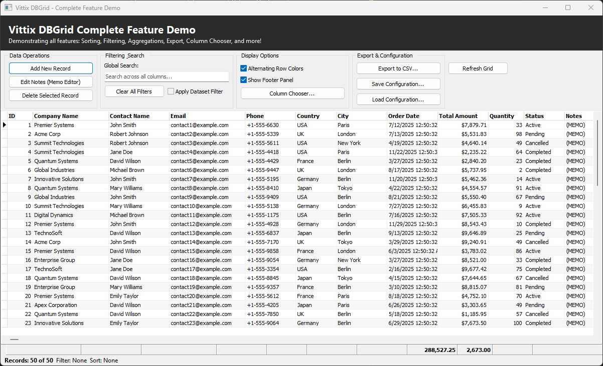
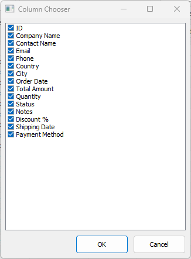
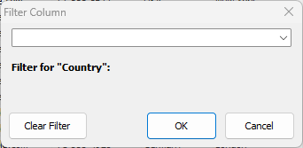

# Vittix.DBGrid

**Vittix.DBGrid** is a modern, feature-rich replacement for Delphi's standard `TDBGrid`, built for professional VCL applications that need advanced data visualization, extensibility, and performance.

---

## Screenshot





> Example showing sorting, filtering, footer aggregations, and column chooser enabled.

---

## Features

- Multi-column sorting engine
- Advanced filtering with popup UI, operator syntax and saved OR-group filter sets
- Optional server-side filtering/sorting (SQL WHERE/ORDER BY via FireDAC; pluggable providers)
- Opt-in FireDAC query paging and VCL navigation bar for large datasets ([API guide](docs/API.md#firedac-query-paging))
- Page-backed dataset with optional automatic page-boundary navigation and a VCL bar for other data sources ([API guide](docs/API.md#page-backed-datasets-from-other-sources))
- Aggregation engine (SUM, COUNT, AVG, MIN, MAX)
- Footer panel with live calculations and selection aggregates
- Runtime column chooser
- Column freezing (fixed left columns) with layout persistence
- Per-column popup editors: pick list, searchable lookup, masked numeric with validation
- Incremental search (type-ahead locate) with a footer hint
- Copy cell or selected rows to the clipboard (Ctrl+C / Ctrl+Shift+C)
- Export to CSV, TSV, XLSX, HTML, XML, JSON, Text and clipboard
- VCL Styles aware footer, filter popup and export dialog
- DUnitX regression suite (382 tests)
- Controller-based architecture
- Pure Object Pascal (Delphi VCL)

Aggregation performs a full dataset scan per recalculation and filters are
re-evaluated per row — correct for tens of thousands of rows; incremental
aggregation for very large datasets is on the
[roadmap](docs/ROADMAP.md) (item 3.1).

---

## Package Structure

The component is delivered using Delphi runtime and design-time packages.

### Runtime Package

```text
VittixDBGridControllerR.dpk
```

Contains all runtime logic required by applications:

- Core `TVittixDBGrid` implementation
- Sorting engine
- Filtering engine
- Aggregation engine
- Footer panel logic
- Column metadata and controller logic
- Custom editors
- Export engine and dialogs

This package must be included with your application.

---

### Design-Time Package

```text
VittixDBGridControllerD.dpk
```

Provides IDE integration and component registration:

- Registers `TVittixDBGrid` in the Tool Palette
- Enables design-time support
- Depends on `VittixDBGridControllerR.dpk`

---

## Main Units

- `Vittix.DBGrid.pas`
- `Vittix.DBGrid.Controller.pas`
- `Vittix.DBGrid.ColumnInfo.pas`
- `Vittix.DBGrid.ColumnChooser.pas`
- `Vittix.DBGrid.Sort.Engine.pas`
- `Vittix.DBGrid.Filter.Engine.pas` - Filtering engine
- `Vittix.DBGrid.Filter.Popup.pas` - Filter popup UI
- `Vittix.DBGrid.Aggregation.Engine.pas` - Aggregation engine
- `Vittix.DBGrid.FooterPanel.pas` - Footer rendering
- `Vittix.DBGrid.Editors.pas` - Custom editors
- `Vittix.DBGrid.Styles.pas` - VCL style color resolution
- `Vittix.DBGrid.Export.Engine.pas` - Export engine
- `Vittix.DBGrid.Export.Dialog.pas` - Export dialog
- `Vittix.DBGrid.Reg.pas` - Design-time registration

---

## Requirements

- Delphi 12 Athens, Win32 (the supported build target for the packages, tests,
  demo, and installer payload)
- VCL framework
- `Vcl.DBGrids`
- `TDataSet` descendants such as FireDAC, ClientDataSet, BDE, ADO, and third-party datasets

> Sorting uses the dataset's `IndexFieldNames` mechanism. Datasets that do
> not publish `IndexFieldNames` (for example `TADODataSet`) raise a clear
> `EVittixSortError` when a sort is applied instead of silently doing
> nothing. On a header click the sort state is rolled back and the error
> is reported through `OnSortError` when a handler is assigned, or
> re-raised otherwise. `TClientDataSet` descendants get true descending
> indexes; other datasets use the FireDAC-style `:D` suffix.

---

## Installation

### Recommended (Package Installation)

1. Open the runtime package:

```text
VittixDBGridControllerR.dpk
```

Build the package.

2. Open the design-time package:

```text
VittixDBGridControllerD.dpk
```

Install the package.

3. Restart Delphi.

The `Vittix.DBGrid` component will appear in the Tool Palette.

---

### Manual Installation (Source Only)

1. Add the source folder to the Library Path.
2. Add the required units to your project.
3. Compile.

> Manual installation does not include design-time support.

---

## Basic Usage

```pascal
uses
  Vittix.DBGrid;

var
  Grid: TVittixDBGrid;
begin
  Grid := TVittixDBGrid.Create(Self);
  Grid.Parent := Self;
  Grid.Align := alClient;
Grid.DataSource := DataSource1;
end;
```

---

## Export

`TVittixDBGridExporter` (drop it next to the grid, or use the grid's export
dialog) writes the visible/selected columns of the bound dataset:

| Format | Notes |
|--------|-------|
| `vefCSV` / `vefTSV` | RFC 4180 quoting, formula-injection neutralization for text |
| `vefExcelXLSX` | Built-in SpreadsheetML writer; typed cells (numbers, booleans, date/time serials with styles), empty cells for NULLs, column widths |
| `vefHTML` | Styled, print-friendly table with display formatting |
| `vefXML` / `vefJSON` | Typed values (numbers, `true`/`false`, `null`); JSON parses cleanly |
| `vefText` | Fixed-width text |
| `vefClipboard` | Any text format to the clipboard |

> `vefPDF` is not implemented (it needs a reporting engine); the export
> dialog never offers it.

For a browser-based print preview, call
`Exporter.OpenHTMLPrintPreview('C:\Reports\grid.html')`, or use **HTML Print
Preview...** in the feature demo. The method saves the full HTML file at the
chosen path and opens it with the system browser; print from the browser.

Options (`Export`): `ExportVisibleOnly`, `ExportFilteredOnly`, `IncludeHeaders`,
`IncludeFooter` (aggregation/footer text row), date/time/float/currency
formats, delimiter/quote/encoding, and an `OnProgress` callback with
cancellation.

Behavior worth knowing:

- **Machine-readable vs display formats.** CSV, TSV, XML, JSON and XLSX
  write numbers with full precision and an invariant decimal separator.
  HTML and Text keep the configured display formats (`FloatFormat`,
  `CurrencyFormat`). Set `ExportLocaleFormat := True` to make the
  machine formats use the locale-aware display formatting instead (for
  consumers who open exports in comma-decimal Excel); in XLSX this writes
  every cell as display text.
- **Dataset friendly.** Exports preserve the current record, temporarily
  lift the grid's filter when `ExportFilteredOnly = False`, and support
  cancellation through `OnProgress` or `Cancel`.
- **Atomic files.** File exports stage a temp file and swap it over the
  target, so a cancelled or failed export never destroys the previous file.

---

## Keyboard

| Keys | Action |
|------|--------|
| printable characters | Incremental search: locate the first record whose primary sort column (or current column when unsorted) starts with the typed buffer; the buffer shows in the footer |
| `Esc` | Clear the search buffer |
| `Backspace` | Remove the last buffer character and re-locate (surrogate pairs go together) |
| `Ctrl+C` | Copy the current cell (or the selected rows under `dgMultiSelect`) as TSV, with headers when `CopyIncludeHeaders` is True |
| `Ctrl+Shift+C` | Same, always with a header row |

Incremental search is controlled by `IncrementalSearch` (default True) and
`IncrementalSearchTimeout` (default 1000 ms); it is suspended while the
in-place editor is open, and matches Unicode-correctly (accented Latin,
Cyrillic, Greek, Indic scripts). `OnIncrementalSearch(Sender, SearchText,
Found)` fires after every keystroke. While an edit is in progress the
clipboard shortcuts belong to the in-place editor's native handling.

---

## Per-Column Editors

A column can open a custom popup editor on F2/double click, configured on
its `ColumnInfo` entry:

```pascal
VittixDBGrid1.ColumnInfo.FindByFieldName('Status').EditorKind := vePickList;
VittixDBGrid1.ColumnInfo.FindByFieldName('Status').PickItems :=
  '1=Active' + sLineBreak + '2=Pending';

Info := VittixDBGrid1.ColumnInfo.FindByFieldName('TotalAmount');
Info.EditorKind := veMaskedNumber;
Info.HasMin := True;  Info.MinValue := 0;
Info.DecimalPlaces := 2;

VittixDBGrid1.ColumnInfo.FindByFieldName('Customer').EditorKind := veLookup;
// uses the field's LookupDataSet / LookupKeyFields / LookupResultField
```

- `vePickList` writes plain captions to string fields and the `value` of
  `value=caption` pairs to integer fields.
- `veLookup` shows a searchable list from the field's lookup dataset and
  writes the key value.
- `veMaskedNumber` accepts digits, one decimal separator (locale or '.')
  and a leading minus (when `MinValue < 0`), honors `DecimalPlaces` and
  the `Min`/`Max` bounds.
- Before any Vittix editor commits, the built-in `Required` and Min/Max
  rules run, then `OnValidateCell(Sender, Column, Field, NewValue,
  Accept, Message)` — on `Accept = False` the message shows and the editor
  stays open. Read-only columns/fields never open an editor. The options
  persist through the layout.

---

## Frozen Columns

`FrozenColumns` (default 0) keeps the leftmost visible columns fixed while
the rest of the grid scrolls horizontally:

```pascal
VittixDBGrid1.FrozenColumns := 2;                 // freeze the first two visible columns
VittixDBGrid1.FreezeUpToColumn(Column);           // freeze through a specific column
VittixDBGrid1.UnfreezeAll;                        // clear the region
```

The count clamps to `0..VisibleColumnCount-1`; frozen and scrolling
regions cannot be crossed by dragging columns (or by the column chooser),
and `OnFrozenColumnsChanged` fires when the region changes. The
configuration persists through the layout's per-column `Pinned` flag and
is cleared by `ResetLayout`.

---

## Filter Operator Syntax

Column filters accept a typed operator prefix (also selectable in the
popup):

| Prefix | Operator | Example |
|--------|----------|---------|
| *(none)* | Contains | `alpha` |
| `=` | Equals | `=Alpha` |
| `^` | Starts With | `^Al` |
| `$` | Ends With | `pha$` |
| `!` | Does Not Contain | `!alpha` |
| `<>` | Not Equals (exact) | `<>Alpha` |
| `>` `>=` `<` `<=` | Numeric comparison | `>250` |
| `..` | Between (pipe-separated) | `150..300` → `>150 \| <300` |
| `!..` | Not Between | `!150..300` |
| `null` / `!null` | Is Null / Is Not Null | |
| `empty` / `!empty` | Is Empty / Is Not Empty | |

Comparisons run numerically when both sides parse as numbers, otherwise as
case-insensitive text. The popup persists the chosen operator per column.

---

## Server-Side Filtering (v2.0, opt-in)

For large datasets the grid can push filtering and sorting into the
database as a parameterized `WHERE` / `ORDER BY` instead of scanning with
`OnFilterRecord` on the client. Client-side evaluation stays the default
and the fallback — nothing changes unless you opt in:

```pascal
uses Vittix.DBGrid.Provider.FireDAC;

// 1. hand the grid a provider bound to your query
VittixDBGrid1.Controller.Provider :=
  TVittixFireDACProvider.Create(FDQuery1);
// 2. opt in (vcmAuto = server when expressible, client otherwise)
VittixDBGrid1.FilterMode := vcmAuto;
```

- Dialects: ANSI, Firebird, SQLite, MySQL/MariaDB, PostgreSQL, SQL Server
  (identifier quoting, LIKE escaping with `ESCAPE`, boolean and NULL
  handling, `NULLS FIRST/LAST` where supported).
- All values travel as typed SQL parameters — user input never becomes SQL
  text, and field names are validated against the dataset's field list.
- `vcmAuto` falls back to the client engine (firing `OnProviderFallback`
  with the reason) when the query shape cannot be wrapped (UNION,
  top-level ORDER BY, semicolons, EXEC/CALL) or a filter depends on client
  display-text semantics. Failing queries restore the original SQL and
  surface through `OnProviderError`.
- Footer aggregates can be computed server-side with one SELECT against
  the same WHERE (falls back to the client scan).
- Limits: the incremental type-ahead search still uses `Locate` on the
  loaded rows — it only sees fetched rows when `FetchOptions` limits the
  fetch; filters with an `OnValidateFilter` hook stay client-side; the
  core package does not depend on FireDAC — ship
  `VittixDBGridControllerFD.bpl` (or use source) to enable it.

---

## Saved Filter Sets

Filters can be saved as named sets and re-applied later. A set is an
ordered list of groups: conditions inside a group are ANDed, groups are
ORed (the classic per-column AND behavior is one implicit group).

```pascal
VittixDBGrid1.Controller.SaveCurrentFilterAs('Big orders');
VittixDBGrid1.Controller.ApplyFilterSet('Big orders');
VittixDBGrid1.Controller.DeleteFilterSet('Big orders');
for Name in VittixDBGrid1.Controller.FilterSetNames do ...
```

- Persistence: the grid's `FilterSetsFileName` (per-grid instance; empty
  resolves to `PersistenceRootPath\filtersets.json`), written atomically
  as versioned JSON. A corrupt file raises `EVittixFilterSetError` instead
  of being dropped.
- Events: `OnFilterSetApplied(Sender, Name)` and `OnFilterSetsChanged`.
- The layout stores the active set's name and re-applies it on load when
  it still exists.
- UI: the filter popup's `Saved...` menu and the manager dialog
  (`TVittixDBGridFilterSetManager`) cover apply/save/rename/delete/reorder
  and group editing. While a set is active, its name shows in the footer.

---

## Layout Persistence

`TVittixDBGrid` exposes a single persistence root plus per-feature file overrides:

- `PersistenceRootPath`
- `LayoutStorageFileName`
- `ChooserStateFileName`
- `FilterHistoryFileName`

Use `PersistenceRootPath` when you want one folder for all saved grid state. Use the per-feature file properties when you want to direct a specific area to an explicit file.

Current behavior:

- explicit file properties take precedence when set
- `PersistenceRootPath` acts as the shared fallback base
- the component keeps persistence wiring internal; application code configures only `TVittixDBGrid`

### Layout schema v2

Layout files carry a `version` field (v1 files without it still load) and
per-column `pinned`, `titleCaption`, `displayFormat`, `exportInclude` and
`exportCaption` settings. The matching properties live on
`TVittixDBGridColumnInfo` (reachable via the grid's `ColumnInfo`):
`Pinned` feeds the frozen-column region, `TitleCaption`/`DisplayFormat`
are pushed onto the grid column and the backing field by `ApplyLayout`,
and `ExportInclude`/`ExportCaption` control the export engine. Unknown
fields from future versions are ignored on load.

### Chooser, filter, and footer behavior

The current chooser and popup surfaces now include a few small but useful affordances:

- chooser search supports multiple terms, a live match summary, `Ctrl+F` focus, `Esc` clear, and `Ctrl+Up` / `Ctrl+Down` reorder
- filter popup supports `Enter` commit, `Esc` cancel, scoped history, distinct-value restriction, and `Not Between`
- footer popup exposes clear-current and clear-all actions, plus keyboard accelerators for those actions

For testability, several of these surfaces expose read-only summary helpers on the corresponding classes. They are intended for regression coverage and diagnostics, not as a new public UI contract.

---

## Testing

The suite is DUnitX-based and covers the export engine, filter engine and
operator table, sort engine, aggregation engine, column info, layout
persistence and controller lifecycle:

```bat
cd tests
build-tests.bat
VittixDBGridTests.exe
```

Set `VITTIX_DELPHI_ROOT` if your Delphi installation is not at the default
`C:\Program Files (x86)\Embarcadero\Studio\23.0`.
